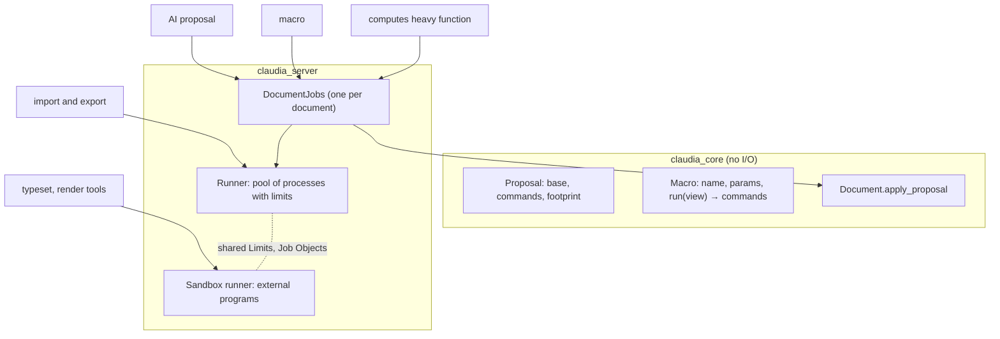

# The macro API and the worker pool (D239, D29, D37, D134, D436; proposal D1309)

*Analysis and proposal for the owner's review, 2026-11-19, branch `e1-core`. Nothing here is built. D239 is the open
"macro API for composes and creates"; the owner remembers worker-pool work done for computes and wants it properly
generalized.*

## 1. What exists

### Four different ways to take work off the event loop

| Mechanism | Where | Used for | Limits |
|---|---|---|---|
| `WorkerPool` over `ProcessPoolExecutor` | `claudia_server/workers.py` (D134), one per server process, shared by the modules (D430) | **the import of Office files only** (`app.py`, `hub.workers.submit(import_state, …)`) | none: no timeout, no cancel, no memory cap (SEC-19), no metrics |
| Subprocess sandbox | `claudia_typeset/sandbox.py`, `_windows.py` (D96–D98) | TeX, Typst, Mermaid and the other render tools | CPU seconds, file size, open files, address space, Windows Job Object, output size |
| One-thread executor | `claudia_ai/runner.py` | the AI model's turns (`Assistant.max_waiting`) | one at a time, bounded queue |
| `asyncio.to_thread` | `admin_fonts.py` | font checks and reloads | none |

The search engine does not offload: it stops at a time budget on the `regex` package (D284, D288).

### What was built for computes, and where it is

The owner is right: there is a first slice, but it is **not on `main`**. Branch `worker-pool` (3 commits, last one
2026-11-13) holds D291–D293:

* `UserFunction.heavy` and `heavy_above`; `Bound.__call__` raises `Deferred` instead of running a call that is over its
  threshold (`functions/base.py`).
* `Calculator.pending_heavy` and `FrozenGrid`: the call's arguments are frozen at the moment of deferral, "a worker
  computes on a copy at revision r" (D37).
* `ApplyCalculated`: the worker's answer lands as a logged command with the final value (non-undoable, like
  `Redacted`), so replay never recomputes it (kernel rule: commands carry final values).
* `HeavyDispatcher` in `claudia_server/heavy_dispatch.py`: one per workbook document, shaped like `Assistant`; runs
  deferred calls on the pool, applies the answer if the inputs did not change, otherwise discards it and retries.
* `WorkerPool.max_waiting` and `PoolBusy` (D293), mirroring `Assistant.max_waiting`.
* `replay_collecting` in the kernel (D292): replay as a pure function of a model and plain entries.

What it does **not** do (by its own notes): it resolves a heavy call only when the call *is* the whole formula
(`=HEAVY(A1:A5)`, not `=HEAVY(A1:A5)+1`); no "calculating" cell state (E4.3); no digests (E4.5); its 30-second timeout
**gives up on the answer but does not stop the worker** (a `ProcessPoolExecutor` cannot kill a running task).

The branch **does not merge cleanly into `main` today**: conflicts in `claudia_core/__init__.py`,
`claudia_server/__init__.py`, `claudia_server/hub.py` and two `tests/api/*.json` files (checked with `git merge-tree`,
2026-11-19).

The E0.2 spike (`notes/e0-shells-and-web-surface.md`) already worked out what a pool needs to be safe: a lifeline pipe,
a parent-sentinel watchdog in every worker, process-tree kill on timeout, kill-busy-first on shutdown. Linux only, and
it is its own warm pool, not the `ProcessPoolExecutor` that `main` uses.

### Macros today

D29 says "users define their own functions **or macros** in Python"; D38 says the admin installs them. Only the
*function* half exists (`UserFunction`, pure, called from a formula, trusted code that runs inside the server). There is
no macro anywhere in the code. Composes and creates have no formulas, so **a macro is the only extension point they
could have**.

## 2. The point of the proposal

Three open things are the same thing seen from three sides:

* a **heavy function** (computes): code that reads a frozen copy and returns a result, off the event loop;
* an **AI proposal** (E7.8, the what-if API of `notes/e1-what-if-api.md`): commands worked out off the main path against a
  copy at revision r, applied only if nothing in their footprint changed;
* a **macro**: code that reads a frozen copy and returns commands.

All three are: **a job on a snapshot at revision r, whose result is final values or commands, applied as one step if the
footprint is unchanged, otherwise refused with the conflicts named.** The kernel already supports every part of it
(plain-data state, commands with final values, `Region.overlaps`, `Batch`). So the generalization is one piece of server
code and one small kernel API, not three.

## 3. Proposal

### Layers



**Layer 0, the runner.** Keep `WorkerPool`'s surface (`submit(fn, *args)`, D134: in `claudia-server`, not the kernel) and
make what is behind it safe, taking the E0.2 design: dedicated worker processes (not `ProcessPoolExecutor`) so a task
can be **killed on timeout**, **cancel**, **`max_waiting` / `PoolBusy`** (D293), a **memory cap** (SEC-19; POSIX
rlimits, Windows Job Objects reused from `claudia_typeset/_windows.py`), the lifetime protocol, and **metrics** (E3.5's
acceptance). One `Limits` dataclass is shared with the subprocess sandbox (seconds, memory, output), so the pool and the
render tools are configured the same way by the administrator. The sandbox keeps its job (external programs); it is not
folded into the pool.

**Layer 1, `DocumentJobs`.** `HeavyDispatcher` generalised: one per hosted document, subscribed to its events like
`Assistant`. A job is `(document, base revision, a picklable function, arguments)`; the function returns **final values
or commands** (never touches the document). On return it asks the document to apply the result as a `Proposal`
(`apply_proposal`, one step, footprint check, discard-and-retry or conflict prompt). Adapters supply what is
app-specific: for computes, the footprint is the frozen call's input range and the application is `ApplyCalculated`
(today's behaviour, unchanged). Computes' heavy functions are therefore the **first adapter**, not a special case.
Lifting the "whole formula only" limit is a separate piece of work in the formula compiler; it does not block this.

**Layer 2, module workers** (D436 step 2) stays as decided: later. Nothing here prevents it: a job's input is plain
data and its result is plain data, so it can cross a process boundary either way.

### The macro API

A macro is **trusted, administrator-installed Python** (D38) that reads a read-only view and returns commands.

```python
class Macro:                       # claudia_core.macros, api: 1
    name: str                      # shown in Tools ▸ Macros
    app: Literal["composes", "computes", "creates", "all"]
    description: str               # one line: the menu tooltip and the help topic (E13.2)
    examples: tuple[MacroExample, ...]   # run as tests when the macro loads, like function examples
    heavy: bool = False            # runs on a worker with the limits; light macros run in the server's own process

    def run(self, view: MacroView, *params) -> None:
        view.edit(...)             # collects the app's own commands; nothing is applied here
```

* **Parameters** are typed like `UserFunction`'s (`str`, `int`, `float`, `bool`, plus `selection` and `thing`), so the
  dialog that asks for them, the checks and the help come from the same annotations (`_kind_of`, `_params_of`).
* **`MacroView`** is a read-only facade of the model (the same read methods the views use, `VIEW_READS`) with
  `edit(command)`. Commands are the **app's own command classes**, validated by their schemas: a macro can do nothing a
  person could not do through the document, and nothing that is not logged and undoable.
* **Result.** `run` produces a `Batch`; the server applies it as the **person who invoked it**, with her rights, as one
  history entry tagged `via macro:<name>` (`Entry.via`, see the what-if note) and one undo step. A viewer cannot run a
  macro. A locked region refuses the whole batch and nothing changes.
* **A document never depends on a macro.** The log holds the commands, which are final values, so **replay never calls
  macro code** and a document opens forever without the macro installed. That is the difference from functions: no manifest
  entry (E1.9), no stale digests. The entry records the macro's name and digest for the audit trail only.
* **Where it runs.** Light macros in the server's own process; `heavy = True` or any macro that exceeds a time budget on
  the worker runner with timeout-and-kill. A macro that was running when the document changed in its footprint answers
  with the conflict prompt, never a silent rebase (D263).
* **Trust.** Same rule as functions (D38): whoever controls the server's folder controls the macros; no code travels in
  documents. The worker protects the server from a crash or a hang; it is **not** a defence against a malicious macro,
  and says so in the administrator's page.
* **Versioned** (`api: 1`) and documented with Sphinx, as every API (E11.5).
* **Computes** keeps `UserFunction` for formulas (D29); macros are available in **all three apps** with one mechanism, so
  the menu is the same everywhere.

### Order of work

1. **Bring `worker-pool` onto `main`.** Resolve the five conflicts; keep D291–D293. Needs the owner's word that nobody is
   still working on the branch.
2. **Harden the runner** (kill on timeout, cancel, memory cap, shared `Limits`, metrics): E3.5, SEC-19.
3. **`Proposal` / `apply_proposal` / `Entry.via` in the kernel**, which the what-if API needs anyway.
4. **`DocumentJobs`:** move `HeavyDispatcher` onto it with no change in behaviour (its tests are the safety net).
5. **`claudia_core.macros`, the server runner, registration, Tools ▸ Macros** (menus and keys in `claudia-menus.xlsx`
   first, mock first), two example macros per app that double as tests, help registration (E13.2).

## 4. For the owner to decide (defaults proposed)

1. **A macro returns commands from a snapshot** (above), rather than getting a live, writable document. Default: yes;
   it is what keeps replay macro-free and makes it undoable as one step.
2. **A macro acts as the person who runs it, immediately, undoable as one step** (no suggest/preview step by default).
   Default: yes; the AI's act/suggest switch (D251–D253) stays about the AI.
3. **Admin-installed and trusted, isolated but not sandboxed** (D38). Default: yes, said plainly in the admin page.
4. **Where macros are invoked:** *Tools ▸ Macros ▸* with one entry per installed macro, in all three apps. This touches
   the common menus, so I am asking rather than deciding: submenu, or one *Macros…* dialog that lists them? And the rule
   "every menu entry has a key": a macro may declare a key, otherwise it has none and is reached from the dialog and
   *Tools ▸ Run macro…* (Ctrl+Alt+M?).
5. **`worker-pool` first, or rewrite on the new layering?** Default: merge it first, then refactor under its tests.
6. **Should a macro run on a what-if first (preview)?** Default: not in the first version; the what-if API makes it
   possible later without changing the macro.
