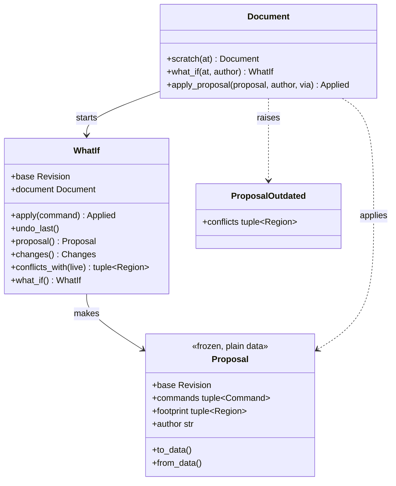

# The what-if API (D236, D263, E7.8; proposal D1308)

*Proposal for the owner's review, 2026-11-19, branch `e1-core`. Nothing here is built yet. D236 is the open question
"branching what-ifs": the owner asked to build the API now, and to check which components already scratch.*

## 1. What exists today

There is one primitive, **a state rebuilt on a private copy**, and several things built around it that do not know
about each other.

| Where | What it does | Kind of copy | Kept how |
|---|---|---|---|
| `Document.materialize(rev)` (`claudia_core/document.py`) | the state after any step, on any line, from the nearest cached snapshot | bare model, read only | not kept |
| `Document.scratch(at)` | a *Document* around a copy: runs commands, undo, events, locks; no log of the live one, no store | full `Document` | not kept |
| `peek_line`, `peek_revision`, `changes_since`, `last_seen` | read-only looks (hidden line, one history step, "what changed since", "when was it last there") | bare model | not kept |
| `_fork_back` (the restore fork, `document.py`) | compares the materialized target with the live state to see whether a restore changes anything | bare model | no |
| `claudia_server/replay.py` `state_at` (`as_of`) | answers a view's dozen read requests for one past step | bare model | 6 states, 30 s |
| `claudia_server/planned.py` (`as_planned`) | the state a redaction would leave, by an opaque token | bare model | 4 plans per document, 15 min |
| `claudia_server/office_export.py` | `model_cls.restore(imported.state)`: the baseline an export patches against | bare model | no |
| `Calculator` / `FrozenGrid` on branch `worker-pool` (D291) | "a worker computes on a copy at revision r" | frozen inputs of one call | until the answer lands |

Findings:

* **`Document.scratch` has no production caller.** Only `test_scratch.py`, `test_scratch_workbook.py` and a
  performance guard use it. It was built as a spike for E7.8 (the AI's suggest mode), and E7.8 is still `todo`.
* **Everything that exists reads.** Nothing in production runs commands on a copy and then offers to *keep* them. That
  is the missing half, and it is what D236 and D263 describe.
* **Two ad-hoc caches** (`replay.py`, `planned.py`) have the same shape (LRU by key, time limit, weak map per document)
  with different limits and keys. A third would be written for the AI's proposals.
* The *redaction plan* is a what-if in spirit (a state that would result, previewed, then carried out) but is not a
  command batch: `plan_redaction` rewrites the store, not only the model. It keeps its own path.
* **Scrubbing back in time** (the second half of D236's title) is built (E5.19, D551). What remains of D236 is *free
  what-if branches*.

Cost, measured in the E7.8 spike: building the copy is the size of the state, not of the history: about 80 ms for 6,000
cells and 1.9 s for 60,000 cells with formulas (they are parsed again); one edit on the copy 0.3 ms. So a what-if is built
**on demand, once per proposal**, and kept while it is used.

## 2. Proposal

### The idea in one sentence

A *what-if* is a private `Document` over a copy, that **remembers the commands it was given** and can hand them back as a
plain-data **proposal** (the revision it started from, the commands, the places they touch). A proposal can be shown, kept,
sent, and **applied to the live document as one step** — or refused as *outdated* with the conflicts named. It is never a
line (D48, D263): no fork, no checkpoint, no merge.

### Core (`claudia_core`, no I/O)

* `Document.what_if(at=None, author=None)` builds on `scratch` (which stays the primitive underneath, and keeps working
  as it does). `at` is any revision on any line.
* `WhatIf.apply(command)` runs it on the copy exactly like `Document.execute` (locks, events, per-author undo of the
  copy) and appends it to the list it remembers. `undo_last()` takes the last one back. A what-if of a what-if is allowed
  (`WhatIf.what_if()`): it starts from the copy's state.
* `WhatIf.changes()` returns the places that differ from where it started, reusing the `regions()` machinery of
  `changes_since`: what the person is shown as "this would change".
* `Proposal` is frozen plain data with `to_data`/`from_data` (commands go through the existing `encode`/`decode`). Its
  **footprint** is the union of its commands' `regions()`, read against the state before each command.
* `Document.apply_proposal(proposal, author, via)`:
  1. finds the entries of the active line after `proposal.base`;
  2. **outdated** if any of them has a region that overlaps the footprint (`Region.overlaps`, E1.5), or is *structural* in
     the same container (a row, column, sheet, slide or paragraph insert or delete: D263's first-version rule, a
     one-line property of the command that apps set);
  3. if outdated: raises `ProposalOutdated(conflicts)` and **nothing changes**: never an automatic rebase;
  4. otherwise runs the commands on the head **as one `Batch`** by `author`, so it is one history entry and one undo
     step, and a locked region refuses the whole thing.
* **Tagging.** D263 says "tagged `via ai`". Composes' text runs already carry `via` (`Run.via`), but the **log entry
  has no such field**. Proposal: `Entry.via: str | None` (pre-release, so no migration, D308), shown in the History &
  Chat panel and kept by redaction. `apply_proposal(..., via="ai")` sets it.

### Server (`claudia_server`)

One `WhatIfDesk` per hosted document, replacing the two ad-hoc caches for what is *kept for a person*:

* **Private to the person who started it.** Token → what-if; nobody else can read or apply it.
* **Limits:** 3 per person, 12 per document, dropped after 15 minutes without use, dropped when the person leaves or the
  document closes. Built when first asked for, never in advance.
* **Views.** `as_what_if(token, method, params)` joins `as_of` and `as_planned` as the third way to read: the views the
  app already has draw it, with the same allow-list of read methods (`VIEW_READS`). `as_of` keeps its small cache,
  because stepping through history is read-only and keyed by revision, not by person.
* **Writing to it.** `what_if_apply(token, method, params)` runs one of the app's *own write methods* on the copy, with
  `ctx.document` swapped for the copy's (the `PastDocument` pattern `replay.py` already uses). So a what-if behaves
  exactly as the live document does, with the **person's own rights** (the rule of D251–D253).
* **Wire methods:** `what_if_start(at?)`, `what_if_apply`, `what_if_changes`, `what_if_commit` (→ `apply_proposal`, a
  conflict answered with a sentence and the places), `what_if_drop`.
* **Stored proposals.** The AI's suggest mode (D263) keeps a `Proposal` with the chat record: that is
  `Proposal.to_data()` in the chat record, nothing new in the store. Opening it builds a what-if from `base` and applies
  the commands.

### Who adopts it, in this order

1. **E7.8, the AI's suggest mode:** the first consumer and the reason the spike exists. The AI's read-act-correct loop
   runs on the what-if; accepting calls `apply_proposal(..., via="ai")`.
2. **Offline merge (2026-11-16 idea):** a source applied to a target as a proposal gives the conflict prompt for free.
3. **Replace all in Search & replace:** show "this would change" before doing it (`changes()`).
4. **Delete style:** the dialog's "14 places will look different" could be read from a what-if instead of a separate
   counting function. Only if it turns out simpler; not a goal.
5. **D37's unlogged drag preview** in computes, later.

Not changed by this: history replay and scrubbing (`materialize`), the redaction plan, the restore fork and checkpoints.

### Tests first (written before the code, in `packages/claudia-core/tests/test_what_if.py`)

Isolation in both directions (exists for `scratch`); `apply` records and `proposal()` round-trips through plain data;
`changes()` names the places; a proposal on a quiet document applies as one step and one undo; an overlapping edit makes
it outdated and **changes nothing**; a structural edit in the same container makes it outdated; a locked region refuses
it whole; nested what-ifs; `via` shown and kept by redaction; the cost guard of the E7.8 spike for building one. For the
server: privacy between two people, limits and expiry, the views read it, `what_if_commit` conflict answer. E2E (spec
first): an AI suggestion previewed and accepted in computes, accepted when outdated.

## 3. For the owner to decide (defaults proposed)

1. **Private per person, in memory, ending with the session** (default). A proposal stored with a chat record is the
   only thing that lives longer. A *named what-if that survives for days* would be a different feature (a private
   drawer, like the binder, D1101–D1116) and is not proposed.
2. **Outdated = overlap with the footprint, or a structural change in the same container** (D263's rule, written as a
   property of the command). Never an automatic rebase.
3. **Limits** 3 per person, 15 minutes idle.
4. **Write methods go through the app's method table** (a what-if behaves exactly like the document), not only raw
   command batches.
5. **`Entry.via`** on the log entry (new field), shown in the History & Chat panel.
6. **Word for people:** "preview" or "suggestion" in the screens, never "what-if" or "scratch"; the screens are their own
   round (mocks first).
