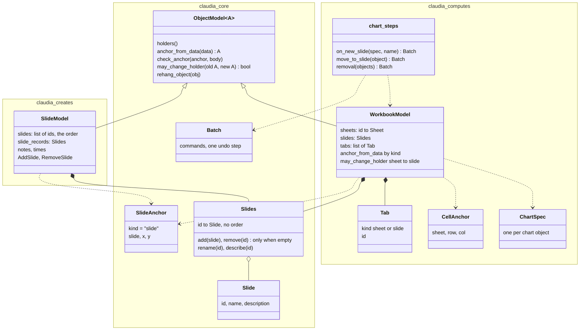
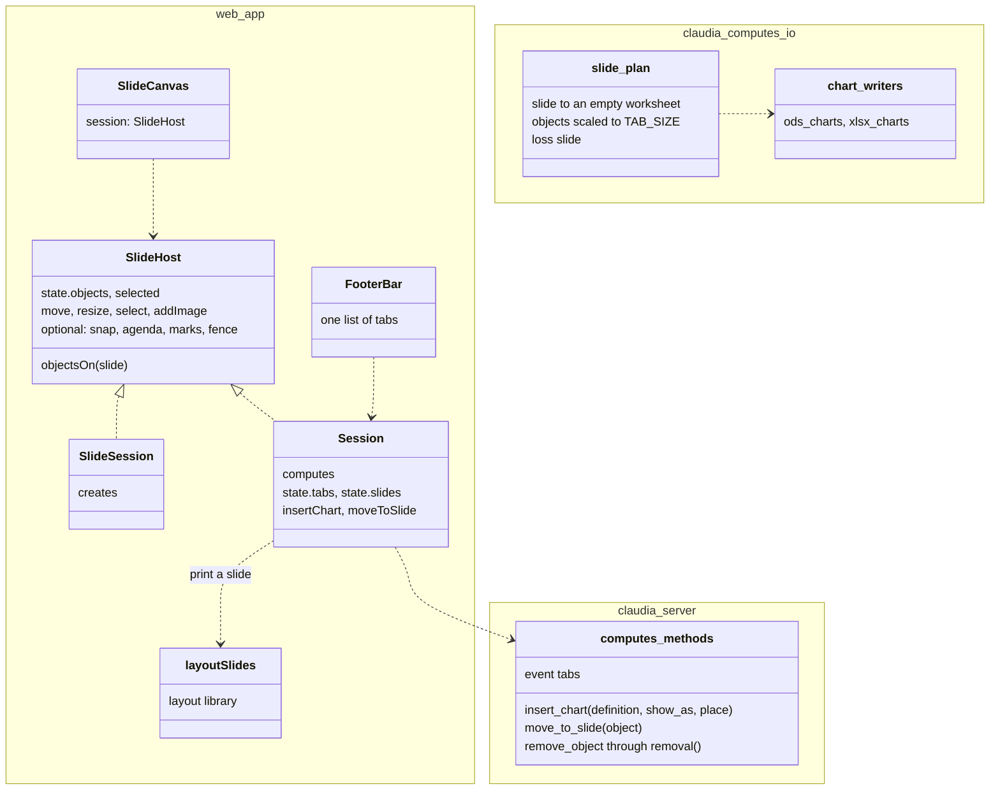

# E6.31 Slides in computes: the architecture

Story: `Projects/claudia-office/_tasks/e6.31-slides-in-computes.md`. Glossary: Slide, Tab, Chart, Holder, Object layer.
Screens: `notes/mockups/computes-slides-1-a-slide-among-the-sheets.svg`, `-2-insert-chart-as-a-slide.svg`,
`-3-move-a-chart-to-a-slide.svg`, and the page "E6.31 Slides in computes" of `penpot/claudia.penpot` (branch `penpot`).
Agreed with the owner on 2026-11-22 (see "Agreed"); decisions D1470 (A1, A2), D1471 (A3′, A4, A10), D1472 (A5)
and D1473 (A6 to A9, superseding D204).

## What the code does today

- A slide in creates is an id in `SlideModel.slides` (the order of the presentation), with its name and description in
  side tables and its objects in the shared object layer (`open_holder`); `SlideAnchor(slide, x, y)` and the 1600 × 900
  frame (`SLIDE_WIDTH`, `SLIDE_HEIGHT`, the bounds rule in `check_anchor`/`turned_anchor`) are creates' own.
- A holder in the core is an id: `Anchor.holder`, `ObjectModel` keeps a stack per holder and asks the app for
  `holders()`, `anchor_from_data()` and `check_anchor()`. The types of the holders are the apps' (computes `Sheet`,
  creates' slide ids), except `Paragraph`, which is in the core because all three apps have text.
- Computes keeps its sheets in `sheets` (the dict's order is the tab order) and its chart tabs in `charts` (`Chart(id,
  name, spec_id)`), in an order of their own after all sheets. A chart tab and a chart object on a sheet may point at
  the same `ChartSpec` (D204); `users_of` keeps the spec while either is left.
- Making a chart takes two or three steps on the wire (`define_diagram`, then `add_diagram_object` and/or `add_chart`).
  `RemoveObject` leaves an object's asset defined. `MoveObject` moves an object to another holder (D1351) only where the
  app allows it (`objects_change_holder`, composes only). `Batch` makes several commands one undo step.
- `SlideCanvas.vue` takes creates' `SlideSession`; besides the shared `BaseSession` it uses `select`, `move`, `resize`,
  `objectsOn`, `addImage`, `selectedByOthers`, and the creates-only `markOf`, `agendaOf`, `setSnap`, `fenceToContainer`.
- Copy and paste is for pictures only, so no chart is ever copied. Nothing in the UI reorders or deletes a tab (UX-68).

## The model

**A1 · The slide in the core** (step 1). `claudia_core/slides.py`: `SLIDE_WIDTH`, `SLIDE_HEIGHT` and `SlideAnchor`
(moved from creates), the rule that keeps an object on the slide (creates' `check_anchor`/`turned_anchor`, as
functions), `Slide(id, name, description)` and `Slides`, a keyed collection without an order of its own that refuses to
remove a slide that still has objects. Why: two apps have slides now, as all three have paragraphs. Creates' stored state
changes from a list of ids plus name and description maps to slide records in the order of the presentation (the
order stays `SlideModel.slides`, as today; the records are `slide_records`): a new state schema, no upgrade (pre-release,
D1430).

**A2 · Each app keeps its own `AddSlide`/`RemoveSlide`.** Creates' carry the notes and the planned time, computes' the
place in the tab order; `Slides` has the shared rules. A core command with optional extras would mix the two apps.

**A3′ · Two collections, one order** (agreed). Computes: `sheets` (id → `Sheet`) and `slides` (id → `Slide`) are what a
sheet and a slide are; `tabs: list[Tab(kind, id)]` is the only order, every sheet and every slide in it exactly once.
That invariant is kept by `add_sheet`, `remove_sheet`, `add_slide`, `remove_slide` and nowhere else. `Tab.kind` says
which collection an id is in, which the web needs too (the grid or the slide). Creates keeps its order as a list of ids
(the presentation). `WorkbookModel` becomes `ObjectModel[CellAnchor | SlideAnchor]`: `anchor_from_data` reads by
`kind`, `check_anchor` wants a cell anchor on a sheet and a slide anchor on a slide, `holders()` follows `tabs`. The
chart tab (`charts`, `Chart`, `AddChart`, `RemoveChart`) goes in step 3.

**A4 · Changing holder: a hook instead of a flag.** The core's `objects_change_holder` becomes `may_change_holder(old,
new)`, the flag's behaviour by default; computes allows sheet → slide only. "Move to Slide" is then the existing
`MoveObject`, and moving an object from one sheet to another does not become possible by the way.

**A5 · One place decides what a chart step takes along**: `claudia_computes/chart_steps.py` returns one `Batch` (one
undo step) for a chart on a new slide (the spec, the slide after the current tab, the chart filling the frame), for
moving a chart to a slide (the slide after the sheet, named after the chart; `MoveObject`; `ResizeObject` to the frame)
and for removing objects (the objects, each chart's spec, and every slide left empty: Q11, Q20). The server, cut and
delete, and later the ai get the same rules without repeating them.

## The server, the web client and the files

**A6 · The wire.** `insert_chart(definition, show_as, place)`: one step instead of `define_diagram` plus
`add_diagram_object` or `add_chart`. `move_to_slide(object)`. Computes' `remove_object` goes through `removal()`.
`add_chart`, `remove_chart` and the event `charts` go; the event `tabs` and the stored keys `tabs` and `slides` come.
`define_diagram` and its relatives are renamed in step 4 (Q17 of the chart session).

**A7 · Web.** `SlideHost` is what `SlideCanvas` needs of a session; creates' `SlideSession` and computes' `Session`
implement it and share the slide's helpers (move, resize, select on slide anchors). Snapping to the grid, the agenda,
search marks and the fence for containers are optional, creates' only. Computes' `Workspace.vue` shows `SlideCanvas`
and the object tools (no Present) for a slide tab; `FooterBar` shows the one list of `state.tabs`. One slide canvas for
both apps: the parity the definition of done asks for.

**A8 · Printing.** A computes slide is printed by the layout library's `layoutSlides`, as creates' slides are, with the
charts as the Plotly pictures `print/chart-picture.ts` makes already.

**A9 · Files.** `claudia_computes_io/slide_plan.py`: a slide becomes an empty worksheet named as the slide with its
objects on it, scaled from 1600 × 900 to today's `TAB_SIZE`; the charts are written by `ods_charts`/`xlsx_charts`; the
loss `slide` replaces `tab`. Import is unchanged: what was a slide comes back as a sheet (Q15).

**A10 · No reordering of tabs.** Nothing in the UI reorders a sheet today; the one tab order comes without a way to move
a tab, and a new slide goes after the current tab. Reordering waits, as deleting a tab does (UX-68).

Untouched: the GTK and Neutralino clients (they show the web page; no new menu entry), the ai (no chart tools), the help
(no chart topic; one would be a story of its own).

## Agreed

- 2026-11-22: A3′ (the owner asked why `WorkbookModel` has sheets, slides and tabs; the answer, two collections and one
  order of references into them, was agreed, and with it a `Slides` without an order of its own).
- 2026-11-22: A1, A2 and A4 to A10, as written here.
