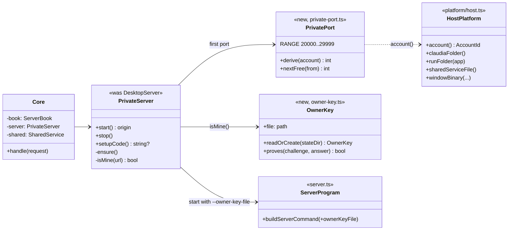
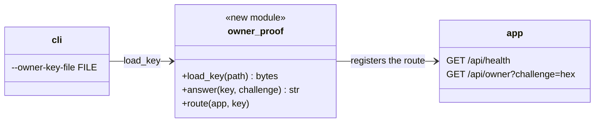
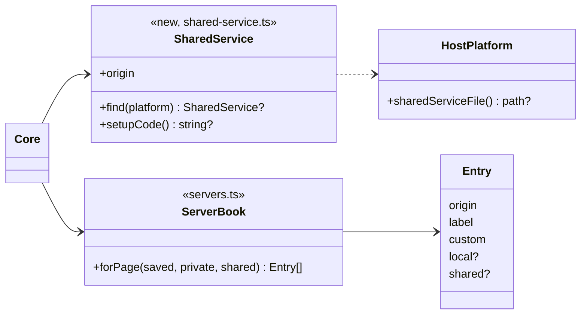
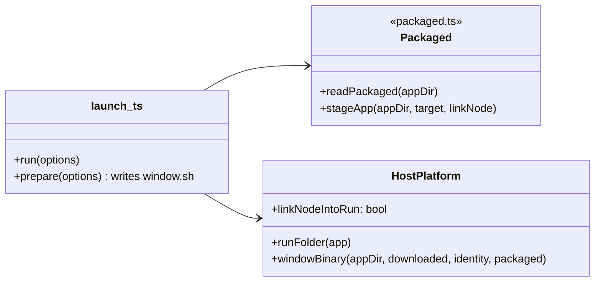

# E8.5 macOS installer: architecture (proposal, 2026-11-25)

Status: **agreed by the owner on 2026-11-25** (with the five answers at the end); the decisions are written when the
range is reserved. It turns the grilling of 2026-11-25 (story
`e8.5-macos-installer.md`) into code placement. Branch `mac-installer`; decisions in the range to be reserved
(D1620–D1639). Three parts, built in this order, because each one needs the one before:

1. **Private on this computer**: a person's apps use only her own server (CODE-99, CODE-100). All three clients and
   the server.
2. **Shared on this computer**: the service is a place of its own. macOS and Windows clients, both installers.
3. **The macOS package**: layout, launcher, build, service, uninstaller, install test.

What was read for it, at `main` `4cca2065`: `clients/neutralino/src/{desktop-server,launch,packaged,servers,core,
connector}.ts`, `src/platform/{host,macos,macos-app-bundle}.ts`, `clients/linux/src/claudia_shell_gtk/desktop_server.py`,
`packages/claudia-server/src/claudia_server/{cli,app,setup_code}.py`, `web/app/lib/{server-bookmarks,mine,setup-code,
open}.ts`, `packaging/windows/*`.

---

## 1. Private on this computer

### What changes in behaviour

* Her own server runs on **a port of her own** in 20000–29999, derived from her account (below the ephemeral ranges of
  all three systems, so the system never hands it to another program), remembered in `desktop-server.json` as today. The
  service, `./start.sh`, Docker and the cloud keep 8765 (D504 for every *shared* server).
* Before her apps use a server they find on her port, they ask it to **prove that it is hers**: the server was started
  with a key from her own state folder and answers a fresh challenge with an HMAC of it. Another person's server, an old
  stray one, or a program pretending cannot answer. Her apps then move to the next free port of the range, remember it,
  and log why. Nothing else about finding and sharing her server among her three apps changes (D445's presence, the
  idle stop, the race of two starts).
* The version check stays for her own server; its message ("stops by itself ten minutes after…") is now true, because
  only her own server is ever compared (CODE-100).

### Placement



* **`desktop-server.ts` becomes `private-server.ts`, `DesktopServer` becomes `PrivateServer`.** The class keeps its
  job (find, start, keep presence); what is new is two small collaborators it is given, so the class does not grow and
  each rule is tested alone. The rename follows the glossary ("Private on this computer"); "desktop server" now says
  nothing, since the service also runs on the desktop.
* **`private-port.ts`** (new, pure): `derive(account)`: on macOS and Linux `20000 + uid % 10000` (macOS accounts
  start at uid 501, Linux at 1000: no two accounts of one computer collide); on Windows there is no uid, so `20000 +
  fnv1a(lower-cased profile folder) % 10000` (a collision between two accounts of one PC is possible and rare, and is
  handled like any taken port). `nextFree` walks the range. Which account: `HostPlatform.account()`, so the rule has no
  `process.platform` in it.
* **`owner-key.ts`** (new): 32 random bytes, hex, in `<server state>/owner.key`, made with mode 0600 at the first start
  (Windows: the per-person `%LOCALAPPDATA%` already keeps others out). `proves(challenge, answer)` compares in constant
  time.
* **Twin in the Linux client:** `desktop_server.py` → `private_server.py`, new `private_port.py`, `owner_key.py`, the
  same rules. To keep the twins from drifting, **one file of test vectors**, `clients/contract/private-port.vectors.json`
  (account → port; key + challenge → answer), is read by the tests of both (the contract folder is what the clients
  share already).

**Server** (`packages/claudia-server`):



* **`--owner-key-file FILE`** and **`GET /api/owner?challenge=<64 hex>`** → `{"answer": "<hex HMAC-SHA256>"}`; 404 when
  the server has no key (every shared server). In a new module `owner_proof.py`, so `app.py` only registers it. The key
  never leaves the server; a challenge is answered, nothing is stored. Loopback only, like `/api/health`'s version.
* Not the access secret: a server with one refuses the page's list and creation (`open.ts` has no way to send it), so it
  cannot double as the proof without a change to the web app (see question 1).

---

## 2. Shared on this computer

### What changes in behaviour

* The installers write a **marker** when the service is installed and remove it when it is removed:
  macOS `/Library/Application Support/Claudia/service.json`, Windows `%ProgramData%\Claudia\service.json`:
  `{"origin": "http://127.0.0.1:8765", "state": "<the service's state folder>"}`.
* Every person's apps read it at start and put the service in her list of servers, after her private place, as
  **Shared on this computer** until its administrator gives it a name (as `{administrator}'s server` today).
* While the service has no administrator, an app of a person who may read its state folder (the computer's
  administrators) sends its setup code with the service's origin, as it does for her private server (D1373). Anyone
  else's page says: "Only an administrator of this computer can name this server's first administrator. Ask one."
  (exact wording in the scenarios).
* **Labels are made by the page, not the shell**, so they are translated: the shell marks entries `local: true`
  (private) or `shared: true` (new); the page shows `t('Private on this computer')` / `t('Shared on this computer')` unless
  the person renamed it. Today the shell sends the English label "This computer" itself (shell messages are English
  only), which the i18n definition of done does not allow for a label on the page.

### Placement



* **`shared-service.ts`** (new): reads the marker, checks that the origin is a loopback address (a marker can only
  point at this computer), and reads the setup code from its `state` when the person may (an unreadable file is "may
  not", never an error). `HostPlatform.sharedServiceFile()`: macOS and Windows their paths, Linux none (no service, Q21).
* **`servers.ts` `forPage`** takes the private and the shared entry; the contract's server entry gets `shared`
  (`clients/contract/shell-contract.v1.schema.json`, an optional field, so v1 stays). Linux's `servers.py` gets the
  field too (it never sets it).
* **Web** (`web/app/lib/server-bookmarks.ts`): `defaultLabel` no longer says "This computer"; an entry flagged `local`
  or `shared` gets the translated name. A loopback server in a plain browser tab (no shell to tell whose it is) is
  shown as "Shared on this computer" (see question 2). `po/` gets both names, German "Privat auf diesem Computer" /
  "Geteilt auf diesem Computer"; "This computer" goes.
* **Windows installer**: `claudia.iss` writes and removes the marker with the service component, grants the
  Administrators group read on the service's state folder (built: `%ProgramData%\Claudia\state`, its `--state-dir`;
  `state\service` is only its log folder) (icacls), and its component text becomes
  "for the people of this computer to share documents". D743's "the apps use the service's documents" is superseded.

---

## 3. The macOS package

### Layout after installation

```
/Applications/claudia composes.app/Contents/          (and computes, creates)
    Info.plist        id de.claudia-office.composes, name "claudia composes", icon, LSMinimumSystemVersion 14.0
    MacOS/claudia-composes      the app's launcher (a shell script, see below)
    MacOS/neutralino            the window: Neutralino's binary, inside the app so macOS shows its name and icon
    Resources/composes.icns
/Applications/Utilities/uninstall claudia.app         an AppleScript applet: runs uninstall.sh with administrator rights
/Library/Application Support/Claudia/
    runtime/node/                Node 22 for darwin-arm64 (pinned by SHA-256)
    runtime/server/claudia-server/   the self-contained server (D740's recipe, built on the Mac)
    runtime/client/              clients/neutralino built for macOS + packaged.json; apps/<app> without bin/
    runtime/web/                 the built web frontend
    runtime/uninstall.sh, VERSION
    service.json                 only with the service
    shared/documents, shared/state   only with the service; owned by _claudia; admin group may read state/admin
/Library/LaunchDaemons/de.claudia-office.server.plist   only with the service
/Library/Logs/Claudia/server.log                          only with the service
```

Each person's own files stay where they are today: `~/Library/Application Support/Claudia/{documents,state,shell.json}`,
the window's working copy in **`~/Library/Caches/Claudia/run/<app>`** (new on the Mac: no space in the path, and
`Caches` is what it is), logs in `~/Library/Logs/Claudia/`.

### The launcher



The app's `MacOS/claudia-composes` is:

```sh
#!/bin/sh
R="/Library/Application Support/Claudia/runtime"; B="$(cd "$(dirname "$0")" && pwd)"; L="$HOME/Library/Logs/Claudia"
mkdir -p "$L"
CLAUDIA_NEUTRALINO_BIN="$B/neutralino" "$R/node/bin/node" "$R/client/dist/launch.js" composes --prepare >>"$L/composes.log" 2>&1 || exit 1
exec /bin/sh "$HOME/Library/Caches/Claudia/run/composes/window.sh" >>"$L/composes.log" 2>&1
```

* **`launch.ts` gets a `--prepare` mode** that does everything up to the window (stage the run folder, write the
  core's command, check the paths) and, instead of starting the window, writes **`window.sh`** into the run folder: the
  window's environment (`buildShellEnvironment`, as `export` lines) and `exec "<binary>" --path=… --res-mode=directory`,
  every value quoted by one tested function (the binary's path has a space: `claudia composes.app`). Both `exec`s keep
  the process macOS launched, so that process **becomes the Neutralino window itself**: one Dock icon, the app's name
  and icon, and quitting the window ends the app. (With node as the launched process and the window its child, macOS would show a
  launched app that never opens a window next to the window's own icon.) A packaged run folder is a fresh copy at every
  start, so nothing has to be put back afterwards, which is what `run()` waits for today.
  The spike of 2026-11-25 showed it works (one Dock icon, name and icon right, unsigned, from a `.pkg`).
* **`windowBinary`** on macOS: in a checkout it builds the small `.app` as today (`macos-app-bundle.ts`); packaged, it
  takes `CLAUDIA_NEUTRALINO_BIN` as it is, because the binary is inside the app already, and **never writes into an
  installation** (that would break the bundle's signature, and the folder is read-only for most people).
  `launch.ts` therefore reads `packaged.json` *before* it asks for the window binary.
* **`runFolder`**: macOS `~/Library/Caches/Claudia/run/<app>`, Windows unchanged.
* **Node's path has a space** (`Application Support`) and a Mac has no short names: `stageApp` puts a symlink `node` →
  the bundled node into the run folder, and the core's command names the link (`HostPlatform.linkNodeIntoRun`,
  macOS only). The "Set LOCALAPPDATA" hint becomes the platform's own words.
* `packaged.json` on the Mac: `{"web": "../web", "server": "../server/claudia-server/claudia-server"}`.

### Build (changed 2026-11-26: built on Linux in CI, the owner's answers Q1–Q7 below)

GitHub's hosted macOS runners do not come for this repository, so nothing of the build may need a Mac. Every step that
did (PyInstaller, `iconutil`, `codesign`, `osacompile`, `pkgbuild`, `productbuild`) has a Linux way:

```
packaging/
  macos/build.py      everything, on any system: stage the runtime, Info.plists, the launcher scripts, packaged.json,
                      the LaunchDaemon plist, distribution.xml, the icons (Pillow writes .icns); check that every
                      Mach-O is signed; make the package       (tests/test_macos_packaging.py)
  macos/flatpkg.py    the flat package's formats: the payload (cpio "odc", gzip) and the xar archive around it;
                      the Bom comes from bomutils' `mkbom`, built in CI from a pinned commit
  macos/macho.py      which files are Mach-O, and whether each carries a code signature (LC_CODE_SIGNATURE)
  macos/third-party.json   CPython 3.14 for macOS arm64 (python-build-standalone), Node 22 darwin-arm64, bomutils:
                      pinned by version and SHA-256
  macos/scripts/      preinstall/postinstall of the two component packages
  macos/resources/    welcome and licence pages, en.lproj and de.lproj
  macos/uninstall.sh, macos/uninstall-app.sh   the uninstaller and the program of "uninstall claudia.app"
  macos/test-install.sh   the install test, on the owner's Mac (or a macOS VM; a macOS runner once there is one)
.github/workflows/macos.yml   on ubuntu-latest: build, read the package back with bsdtar and check it, keep it 30 days;
                      a tag v* attaches it to the GitHub release (as windows.yml and deb.yml); the install-test job is
                      written and switched off (`if: false`) until a macOS runner exists
```

* **The server** is not a PyInstaller build (PyInstaller cannot build for macOS on Linux): `runtime/python/` is a
  relocatable CPython 3.14 for macOS arm64 (python-build-standalone, what uv installs), with the server and its
  dependencies installed into it for macOS (`uv pip install --python-platform aarch64-apple-darwin --target`, from the
  lock file: every dependency has a macOS arm64 wheel). `runtime/server/claudia-server` is a short script that runs
  `python -m claudia_server`, so the apps (`packaged.json`) and the LaunchDaemon call one path. Windows keeps its
  PyInstaller recipe where it is (answer 4 below no longer concerns the Mac).
* **Signatures:** Apple Silicon runs no unsigned code; an ad-hoc signature is enough, and what was built on a Mac
  (CPython, Node, Neutralino, the wheels' libraries) carries one. Nothing is changed in them, so nothing is signed: the
  build fails if a Mach-O file has no signature (`macho.py`). `rcodesign` (Linux) signs ad-hoc only if one ever lacks it.
* **Icons** with Pillow instead of `iconutil`; **"uninstall claudia.app"** is a small app whose program is a shell
  script asking for an administrator through `osascript` (`with administrator privileges`), instead of an applet made
  with `osacompile`: the same dialog.
* **What CI checks:** structure, file list, scripts, plists, signatures, versions of the package as `bsdtar` reads it.
  **What it cannot:** installing it. The first install of each change is the owner's, with `test-install.sh`; whether a
  downloaded unsigned package needs "Open Anyway" is learnt there.

* **`productbuild`** makes one `claudia-office-<version>-macos-arm64.pkg` from two component packages: **apps**
  (required) and **service** (`start_selected="false"`, so off by default in "Customize").
* **apps** `preinstall`: stop the service if it is loaded (`launchctl bootout`); `postinstall`: start it again if its
  plist is there (Q5: an update keeps and restarts it).
* **service** `postinstall`: create the hidden account and group `_claudia` (`dscl`, a free uid below 500), the
  `shared/` folders owned by it, an inherited read ACL for the `admin` group on `shared/state/admin`, the marker, then
  `launchctl bootstrap system`. The daemon runs `claudia-server --host 127.0.0.1 --port 8765 --dir …/shared/documents
  --state-dir …/shared/state --no-tls`, `KeepAlive`, logs to `/Library/Logs/Claudia/`.
* **`uninstall.sh`** (as root, through the applet's `with administrator privileges`): stop and remove the daemon and
  its plist, end every claudia process started from `runtime/`, remove the marker, give `shared/` to `root:admin` and
  delete `_claudia`, remove the apps, the applet and `runtime/`, `pkgutil --forget` both receipts; then say what is left
  (`shared/documents` and each person's own folder) and where.
* **`test-install.sh`**: the macOS twin of `windows.yml`'s test job: install with and without the service (`installer
  -pkg … -applyChoiceChangesXML`), check files, the daemon (running, `_claudia`, answers on 8765, passes
  `packaging/smoke_server.py`), the marker, an app's `--prepare`, a real window (allowed to fail without a display),
  update over itself, uninstall, and that only documents and settings are left and no process runs.

---

## Decisions this would write (D1620–D1639)

| # | Decision | Changes |
|---|---|---|
| D1620 | A person's apps use only her own server, proven by a key in her state folder | D445 (amends), CODE-99 |
| D1621 | Her own server's port is derived from her account, 20000–29999, remembered | D504 (8765 stays for shared servers) |
| D1622 | A service is a place of its own, found through a marker the installer writes | D743 (supersedes its "apps use the service's documents") |
| D1623 | Place names are made by the page: Private / Shared on this computer | D243's "This computer" |
| D1624 | The computer's administrators can read the service's setup code | D1371 (where the code is said) |
| D1625 | The macOS package: an unsigned `.pkg`, apps + optional service, Apple Silicon, macOS 14; its server a relocatable CPython | E8.1's macOS line |
| D1626 | The macOS app is a launcher script that execs the window inside its own bundle | the minimal `.app` of `macos-app-bundle.ts`, for an installation |
| D1627 | The macOS service is a LaunchDaemon under its own account `_claudia` | mirrors D743 |
| D1628 | Uninstalling on macOS is an applet that leaves documents and each person's settings | |
| D1629 | The macOS package is built on Linux in CI and attached to each release; installing it is tested on the owner's Mac | D742 (testing by installing) |

## The owner's answers (2026-11-25)

1. **"For her alone", fully:** not in E8.5; a story of its own, [[e5.22-private-place-for-her-alone|E5.22]].
2. **A loopback server in a plain browser tab** is "Shared on this computer": yes.
3. **Rename** `DesktopServer` → `PrivateServer` (and the Linux twin): yes.
4. **Move** the server's PyInstaller recipe to `packaging/server/`: yes.
5. **Order of work:** the launcher spike on the owner's Mac, then part 1, part 2, the package: yes.

## Risks and what is not known

* ~~One Dock icon with an `exec`'d window~~: **settled by the spike** on the owner's Mac (2026-11-25, macOS 27.2.1):
  one app, its name and icon, unsigned from a `.pkg`; see `spikes/e8-5-mac-launcher/README.md`.
* ~~Whether installed files carry quarantine~~: they do not (spike). Still open: whether a *downloaded* `.pkg` needs
  "Open Anyway" (the spike's was built on the same Mac); the install test uses a downloaded copy.
* Whether an inherited ACL on `shared/state/admin` survives the server's own `chmod 0700/0600` (expected: yes, macOS
  keeps ACL entries over a mode change); the install test checks that an administrator can read the code.
* Windows: the profile-folder hash may collide between two accounts on one PC (handled as a taken port, and logged).
* Existing per-person Mine, collections and server bookmarks of `127.0.0.1:8765` look empty once (accepted, Q15).

## The owner's answers on building in CI (2026-11-26)

GitHub's macOS runners never come, but the package is to be built in CI and offered with each release like the Windows
installer and the Debian package. Q1 build on `ubuntu-latest`: yes. Q2 relocatable CPython plus the server's macOS
wheels instead of PyInstaller: yes. Q3 xar and cpio written in Python, the Bom by `mkbom` from a pinned commit, the
package read back with `bsdtar` in CI: (c). Q4 no signing step, a check that every Mach-O is signed: yes. Q5 the
uninstaller a script app with `osascript`, icons with Pillow: yes. Q6 `macos.yml` like `windows.yml` (pull requests,
main, by hand; 30 days; attached to the release of a tag), its install-test job written and off: yes. Q7 the first
install is the owner's, with `test-install.sh`: ok. The `macos-latest` entry of ci.yml's Python job stays off.
