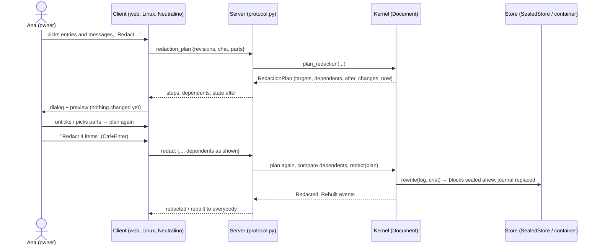
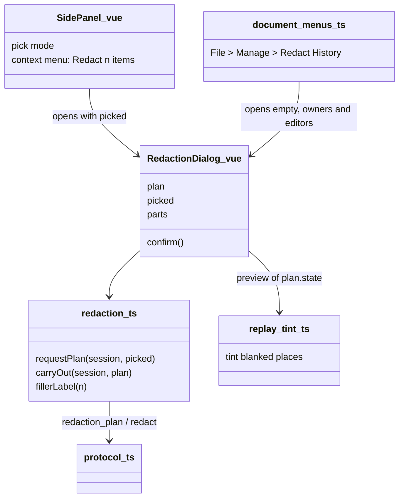

# Redaction: the screens (E3.14)

Status: **built (2026-11-18, E3.14).** The rules behind it are decided (D720–D729, superseding D229) and built in the
kernel, the container and the server (E1.8, E2.6, SEC-05). What was built differs from the mock-ups in a few places,
listed at the end; the mock-ups stay as the record of what was agreed.

## The four screens

| Mock-up | What it shows |
|---|---|
| `mockups/redaction-01-pick.svg` (`.png`) | Picking: an owner Ctrl+clicks two changes and a chat message in History & Chat; the context menu offers **Redact 3 items…** (Shift+Del). |
| `mockups/redaction-02-plan.svg` | The plan: what goes and what it becomes, the later step that goes with it (amber), what this means in words, an optional chat note, and a red button that names the scope. The document behind shows the preview. |
| `mockups/redaction-03-after.svg` | Afterwards: hatched entries with filler of the same length, "Message redacted", the redaction as its own entry, a toast naming the server. |
| `mockups/redaction-04-import-parts.svg` | An import (composes): everything, or only the paragraphs, pictures and boxes picked in the text. |
| `mockups/redaction-05-editor.svg` | An editor whose redaction would blank somebody else's later step: the reason, the red button off, "Ask an owner" with a chat note. |

## The flow

## Menus, keys, who sees what

| Where | Entry | Key | Who |
|---|---|---|---|
| History & Chat, context menu of picked entries | Redact *n* items… | Shift+Del | owners on anything, editors on their own entries (D727) |
| File ▸ Manage | Redact History… | Ctrl+Shift+Alt+E (free in all three apps) | owners and editors |

* The same two entries in composes, computes and creates, in the web client and the shells; the shells take
  `File ▸ Manage ▸ Redact History…` from the shared manifest (`clients/linux/src/claudia_shell_gtk/manifest.py`), so
  `keyboard-shortcuts.md` is regenerated, never edited.
* Viewers and the AI never see either entry. For an editor, "Redact…" is greyed on somebody else's entries, and a plan
  that would blank somebody else's later step comes back with `allowed: false` and their names (mock-up 5).
* A private chat message can only be picked by someone who can read it.
* The chat note (D728) is ticked when the dialog opens; the client posts it with `chat` after `redact` succeeds.
* Every string goes through `po/claudia.pot` (the four server messages are already there, with German).

## Accessibility (BITV)

* The dialog is a modal with a focus trap (as `Modal.vue`), its title is the scope ("Redact 4 items for good").
* The picked rows have checkboxes, not only a colour bar; the amber dependents have a text label, not only a colour.
* Filler `█` is announced as "redacted, *n* characters", never read out character by character.
* The danger button is reached by Tab and by Ctrl+Enter; Enter alone does not redact.

## Where the code goes (web client; the shells show the web client)

* `web/app/lib/redaction.ts`: the two requests, the plan as the dialog needs it, and nothing visual (unit-tested like the
  other `lib` modules).
* `web/app/components/RedactionDialog.vue`: the dialog of mock 2 and 4, on top of `Modal.vue`; the preview reuses the
  replay's tint (`replay-tint.ts`) on the plan's `state`, so a redaction preview and a replay look alike.
* `SidePanel.vue`: pick mode and the context menu entry; `document-menus.ts` and the manifest: the File ▸ Manage entry.
* The import's "Pick in the text…" uses each app's own selection (paragraphs, ranges, slides and objects) and sends
  their ids as `parts`.

## Answered (2026-11-17)

1. **Chat note:** an option, on by default (D728).
2. **Confirmation:** the red button that names the scope, with Ctrl+Enter; no typed confirmation for now (D728).
3. **Editors:** redact their own changes and messages; owners anything (D727).
4. **Parts of an import:** whole objects; single words may come later (D728).

## As built (2026-11-18)

* **The panel is the real one**, dark, with History and Chat as two lists (the mock-ups drew a lighter combined dock).
  Picking works the same: right-click a row (menu: "Redact… (n picked)", Shift+Del), Ctrl+click a row, or
  File ▸ Manage ▸ Redact History… (Ctrl+Shift+F8) for pick boxes on every row and a bar with "Redact…".
* **The dialog sits in the middle** like every dialog and can be dragged aside by its title; the document behind it is
  the preview, with an Iris banner that says nothing has changed yet. The marks are the replay's (`viewTints`), drawn
  from the places the plan names.
* **The button is the rose of "Delete From Server…"**, not GNOME's red: `app.css` keeps `--danger` for the server
  pages, and a document-level act that cannot be undone uses rose (DeleteDocumentDialog.vue). It reads "Redact (n)",
  the title "Redact for good": the catalogue has no plural forms yet, so no "1 items".
* **An import's parts** are picked by clicking paragraphs, slides, sheet tabs and objects while a bar at the bottom
  counts them (the dialog steps aside); computes adds a field for a cell range on the sheet on show. Each part is shown
  by its first words, read when it is picked.
* **A plan that cannot be made** says why inside the dialog, since a notice would sit behind it.
* **A dependent whose blank still fails becomes a tombstone** (D729), found with the editor case of mock-up 5.
