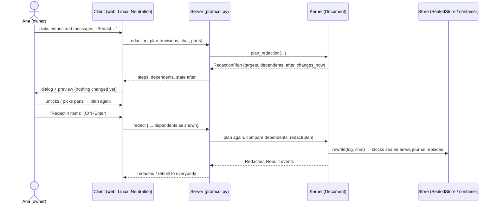
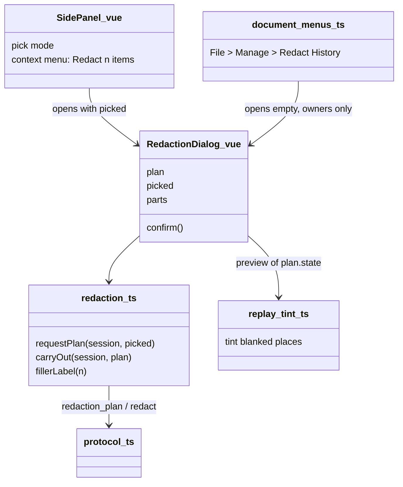

# Redaction: the screens (E3.13), proposed

Status: **proposal, not agreed.** The rules behind it are decided (D720–D726, superseding D229) and built in the kernel,
the container and the server (E1.8, E2.6, SEC-05). This note is what the clients would show; no client code exists yet.

## The four screens

| Mock-up | What it shows |
|---|---|
| `mockups/redaction-01-pick.svg` (`.png`) | Picking: an owner Ctrl+clicks two changes and a chat message in History & Chat; the context menu offers **Redact 3 items…** (Shift+Del). |
| `mockups/redaction-02-plan.svg` | The plan: what goes and what it becomes, the later step that goes with it (amber), what this means in words, an optional chat note, and a red button that names the scope. The document behind shows the preview. |
| `mockups/redaction-03-after.svg` | Afterwards: hatched entries with filler of the same length, "Message redacted", the redaction as its own entry, a toast naming the server. |
| `mockups/redaction-04-import-parts.svg` | An import (composes): everything, or only the paragraphs, pictures and boxes picked in the text. |

## The flow

## Menus, keys, who sees what

| Where | Entry | Key | Who |
|---|---|---|---|
| History & Chat, context menu of picked entries | Redact *n* items… | Shift+Del | owners |
| File ▸ Manage | Redact History… | Ctrl+Shift+Alt+E (free in all three apps) | owners |

* The same two entries in composes, computes and creates, in the web client and the shells; the shells take
  `File ▸ Manage ▸ Redact History…` from the shared manifest (`clients/linux/src/claudia_shell_gtk/manifest.py`), so
  `keyboard-shortcuts.md` is regenerated, never edited.
* Editors, viewers and the AI never see either entry. A private chat message can only be picked by someone who can read it.
* Every string goes through `po/claudia.pot` (the four server messages are already there, with German).

## Accessibility (BITV)

* The dialog is a modal with a focus trap (as `Modal.vue`), its title is the scope ("Redact 4 items for good").
* The picked rows have checkboxes, not only a colour bar; the amber dependents have a text label, not only a colour.
* Filler `█` is announced as "redacted, *n* characters", never read out character by character.
* The danger button is reached by Tab and by Ctrl+Enter; Enter alone does not redact.

## Where the code goes (web client; the shells show the web client)

* `web/app/lib/redaction.ts`: the two requests, the plan as the dialog needs it, and nothing visual (unit-tested like the
  other `lib` modules).
* `web/app/components/RedactionDialog.vue`: the dialog of mock 2 and 4, on top of `Modal.vue`; the preview reuses the
  replay's tint (`replay-tint.ts`) on the plan's `state`, so a redaction preview and a replay look alike.
* `SidePanel.vue`: pick mode and the context menu entry; `document-menus.ts` and the manifest: the File ▸ Manage entry.
* The import's "Pick in the text…" uses each app's own selection (paragraphs, ranges, slides and objects) and sends
  their ids as `parts`.

## Open points for the owner

1. **A chat note** (mock 2) is optional and off by default. Should telling the people whose work was blanked be on by
   default, or always?
2. **Typed confirmation.** The mock uses a red button that names the scope and Ctrl+Enter, as the server pages do. Some
   tools ask the person to type the document's name for an irreversible act. Wanted here?
3. **Editors.** D726 lets only owners redact. Should an author be able to redact *her own* chat messages without an
   owner?
4. **Finer parts of an import** (a few words inside one paragraph) are not offered (D723); paragraphs, pictures, boxes,
   ranges and slides are the units. Enough?
